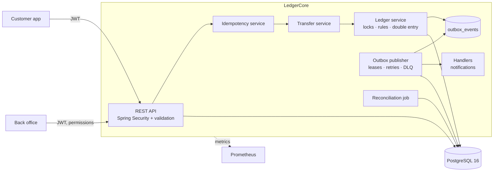
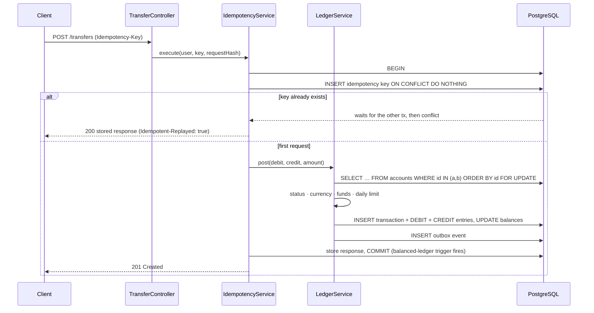

# LedgerCore

A production-inspired **banking and payment-processing platform** built with Java 21, Spring Boot 3 and PostgreSQL 16.
Customers hold accounts and send money; staff run a role-based back office. The interesting part is *how it stays correct*:
balances cannot drift under concurrency, a retried request cannot pay twice, and downstream failures are retried without ever
touching the money.

> **Verification status (please read):** the SQL schema, the database-level guarantees and the locking/idempotency/outbox
> algorithms were executed and verified on a real PostgreSQL 16 (see [What was verified](#what-was-verified-and-what-was-not)).
> The Java sources were syntax-checked and cross-reference-checked with `javac`, but **could not be compiled or run against
> Spring in the environment this was authored in** (no access to Maven Central). Run `mvn verify` once; if anything fails to
> compile it will be a small, local fix.

## What recruiters (and auditors) look for, and where it lives

| Requirement | How it is achieved | Proven by |
|---|---|---|
| **Financial correctness**: balances never become inconsistent under simultaneous transfers | Double-entry ledger; both accounts row-locked with `SELECT … FOR UPDATE` **in id order** inside one transaction; rules checked against locked balances; DB `CHECK` forbids overdrafts; deferred trigger rejects unbalanced transactions; append-only ledger | `TransferConcurrencyIT` (400 random concurrent transfers, opposing A↔B, hot account, daily limit), `LedgerIntegrityIT`, `verify_db_invariants.py` |
| **Duplicate-payment protection** | Mandatory `Idempotency-Key`; key row + transfer + stored response commit in one transaction; PK conflict makes concurrent duplicates wait, then replay | `IdempotencyIT` (20 concurrent identical requests → one debit) |
| **Reliable event processing** | Transactional outbox, `SKIP LOCKED` leases, exponential backoff + jitter, dead-letter state, operator replay, inbox for exactly-once handler effects | `FailureRecoveryIT` |
| **Security** | Spring Security, stateless JWT, rotating refresh tokens with reuse detection, roles → fine-grained permissions, lockout, rate limiting, ownership checks | `SecurityApiIT` |
| **Automated testing** | 21 unit tests + 39 integration/concurrency/failure-recovery tests on real PostgreSQL via Testcontainers | `mvn verify` |
| **Deployment** | Docker, Compose, GitHub Actions CI, OIDC-based CD to AWS ECS Fargate, Terraform (VPC, RDS, ALB, Secrets Manager, autoscaling, alarms) | `.github/workflows`, `deploy/terraform` |
| **Admin** | Permission-guarded back office: users and roles, freeze/unfreeze, limits, deposits/withdrawals, reversals, audit log, outbox replay, reconciliation, stats | `AdminController`, `SecurityApiIT`, `ApiFlowIT` |

## Architecture



### Anatomy of a transfer (one database transaction)



If anything throws, **everything** (debit, credit, entries, outbox event, idempotency key) rolls back together.

## Quick start

```bash
cp .env.example .env              # set POSTGRES_PASSWORD and JWT_SECRET (openssl rand -base64 48)
docker compose up --build         # API on :8080, Swagger UI at http://localhost:8080/swagger-ui.html
```

First admin is created from `BOOTSTRAP_ADMIN_EMAIL` / `BOOTSTRAP_ADMIN_PASSWORD`. Change that password.
Without Docker: run PostgreSQL, set `DB_URL`, `DB_USERNAME`, `DB_PASSWORD`, `JWT_SECRET`, then `mvn spring-boot:run`.

### Walk-through

```bash
API=http://localhost:8080/api/v1

# 1. two customers
for u in alice bob; do
  curl -s $API/auth/register -H 'content-type: application/json' \
    -d "{\"email\":\"$u@example.com\",\"password\":\"Str0ng-Passw0rd\",\"fullName\":\"${u^} Test\"}"; done
ALICE=$(curl -s $API/auth/login -H 'content-type: application/json' -d '{"email":"alice@example.com","password":"Str0ng-Passw0rd"}' | jq -r .accessToken)
BOB=$(curl -s $API/auth/login   -H 'content-type: application/json' -d '{"email":"bob@example.com","password":"Str0ng-Passw0rd"}'   | jq -r .accessToken)

# 2. accounts
A=$(curl -s -X POST $API/accounts -H "Authorization: Bearer $ALICE" -H 'content-type: application/json' -d '{"currency":"NGN"}')
B=$(curl -s -X POST $API/accounts -H "Authorization: Bearer $BOB"   -H 'content-type: application/json' -d '{"currency":"NGN"}')

# 3. admin funds Alice (amounts are integer minor units: 500000 = NGN 5,000.00)
ADMIN=$(curl -s $API/auth/login -H 'content-type: application/json' -d '{"email":"admin@ledgercore.local","password":"<bootstrap password>"}' | jq -r .accessToken)
curl -s -X POST $API/admin/accounts/$(echo $A | jq -r .id)/deposit -H "Authorization: Bearer $ADMIN" \
  -H "Idempotency-Key: dep-$(uuidgen)" -H 'content-type: application/json' -d '{"amountMinor":500000,"description":"cash-in"}'

# 4. Alice pays Bob. Run it twice with the SAME key: the second call replays, money moves once.
KEY=pay-$(uuidgen)
for i in 1 2; do
  curl -si -X POST $API/transfers -H "Authorization: Bearer $ALICE" -H "Idempotency-Key: $KEY" -H 'content-type: application/json' \
    -d "{\"fromAccountId\":$(echo $A | jq .id),\"toAccountNumber\":\"$(echo $B | jq -r .accountNumber)\",\"amountMinor\":150000,\"currency\":\"NGN\",\"description\":\"rent\"}" | head -1
done   # HTTP/1.1 201, then HTTP/1.1 200 (+ Idempotent-Replayed: true)
```

## Security model

| Role | Permissions |
|---|---|
| `CUSTOMER` | `TRANSFER_CREATE`, `ACCOUNT_READ_OWN` |
| `SUPPORT` | `ACCOUNT_READ_ANY`, `TRANSACTION_READ_ANY` |
| `AUDITOR` | `AUDIT_READ`, `ACCOUNT_READ_ANY`, `TRANSACTION_READ_ANY`, `RECONCILE_RUN` |
| `ADMIN` | everything, including `USER_MANAGE`, `ACCOUNT_FREEZE`, `ACCOUNT_LIMIT_UPDATE`, `LEDGER_ADJUST`, `TRANSACTION_REVERSE`, `OUTBOX_MANAGE` |

Endpoints check **permissions** (`@PreAuthorize("hasAuthority('…')")`), not role names. Further controls: BCrypt passwords with a
policy; 5 failed logins lock an account for 15 minutes; unknown-email and wrong-password responses are identical (and
timing-equalised); 15-minute access tokens plus single-use refresh tokens (reuse revokes the whole family); a disabled user
cannot move money even with a still-valid token; other customers' accounts return 404 (no existence leak); auth endpoints are
rate-limited; the actuator runs on a private management port; every admin mutation is audited in an append-only table;
errors are RFC 7807 problem documents that never leak stack traces.

## Testing

```bash
mvn verify                       # unit tests (surefire) + integration/concurrency/failure tests (failsafe, Testcontainers)
python3 scripts/verify_db_invariants.py     # DB-level proof, needs a local PostgreSQL (psql + psycopg2)
python3 scripts/verify_sql_statements.py    # prepares every SQL string in the code against the real schema
```

- **Unit (21):** account rules and overflow, money formatting, JWT signing/expiry/forgery, rate limiter, backoff, idempotency hash.
- **Concurrency (`TransferConcurrencyIT`, `IdempotencyIT`):** conservation of money under 400 random concurrent transfers with 32 threads; opposing transfers never deadlock; a hot account allows exactly the affordable debits; the daily limit cannot be bypassed by racing requests; 20 identical requests debit once.
- **Failure recovery (`FailureRecoveryIT`):** a crash *between the debit and the credit* leaves no trace (balances, ledger, outbox and idempotency key all roll back, and the same key can then be retried); a failing notification provider is retried with backoff and delivered exactly once; permanent failure dead-letters and an operator replay delivers; a crashed worker's lease expires and the event is reclaimed; redelivery of a handled event repeats no side effect.
- **Integrity (`LedgerIntegrityIT`):** the database refuses UPDATE/DELETE/TRUNCATE on the ledger and audit log, refuses unbalanced transactions and negative customer balances; reconciliation detects tampering; reversals work once and never edit history.
- **Security (`SecurityApiIT`, `ApiFlowIT`):** 401/403/404 behaviour, RBAC per role, forged/expired tokens, lockout, refresh-token theft detection, tenant isolation, input validation, and the full customer journey over HTTP.

## Observability

Prometheus metrics at `:8081/actuator/prometheus` (HTTP, JVM, Hikari plus `ledgercore_transactions_posted_total`,
`ledgercore_transfers_rejected_total{code}`, `ledgercore_outbox_backlog`, `ledgercore_outbox_dead`,
`ledgercore_reconciliation_discrepancies`). `deploy/observability/alerts.yml` ships alert rules (reconciliation drift,
dead letters, backlog, 5xx rate, pool saturation). Logs carry an `X-Request-Id` correlation id. Liveness/readiness probes at
`/actuator/health/{liveness,readiness}`. A nightly reconciliation job (single-instance via an advisory lock) proves the books.

## CI/CD and AWS

- **CI** (`ci.yml`): `mvn verify` (Testcontainers), database-invariant scripts, Docker build, **Trivy** scan, container smoke test. **CodeQL** and **Dependabot** are included.
- **CD** (`deploy-aws.yml`): after CI passes on `main`, assumes an AWS role via **GitHub OIDC** (no stored keys), pushes an immutable image tag (git SHA) to ECR, swaps the image in the task definition, rolls out to **ECS Fargate** with a deployment circuit breaker (automatic rollback), and runs a smoke test. The `production` environment can require manual approval.
- **Infrastructure** (`deploy/terraform`): VPC with private subnets, **RDS PostgreSQL 16** (encrypted, TLS enforced, backups, optional Multi-AZ, password generated and held in Secrets Manager), ALB (HTTPS when a certificate is supplied), ECS service with autoscaling, least-privilege IAM, CloudWatch alarms.

```bash
cd deploy/terraform && cp terraform.tfvars.example terraform.tfvars   # edit values
terraform init
terraform apply -target=aws_ecr_repository.app                        # 1. create the registry
# 2. push an initial image tagged "bootstrap" to the ECR repo, then:
terraform apply                                                       # 3. everything else
# 4. set GitHub repo variables: AWS_REGION, AWS_ROLE_ARN (output), ECR_REPOSITORY, ECS_CLUSTER, ECS_SERVICE, ECS_TASK_FAMILY, APP_URL
```

## Design decisions and trade-offs

- **Pessimistic locking over SERIALIZABLE.** Two row locks per transfer in id order are simple, predictable and deadlock-free. SERIALIZABLE would need retry loops on serialization failures. `@Version` remains as defence in depth.
- **Balance column plus ledger.** Reads are O(1); correctness is *proved* by reconciliation (stored balance = sum of entries; all balances sum to zero; no unbalanced transaction) and guarded by database constraints.
- **Idempotency stores successes only.** A rejected request (e.g. insufficient funds) rolls back, key included, so it can be retried after the cause is fixed. The cost: a deterministic rejection is re-evaluated, not replayed.
- **Outbox polling over CDC.** Polling with `SKIP LOCKED` is operationally simple. At very high volume move to logical replication/Debezium. Delivery is at-least-once; the inbox gives exactly-once for database effects, while an external provider (email/SMS) should be given the event id as its own idempotency key.
- **Entities are never loaded before the row lock.** Authorisation uses a read-only projection (`AccountRef`), because an entity read earlier in the transaction would keep a stale, unlocked balance in Hibernate's persistence context.
- **Integer minor units everywhere**, never floating point. Currency is validated, and transfers are single-currency.
- **Known limits and next steps:** no FX or cross-currency transfers; HS256 JWTs (use asymmetric keys or KMS across services); the rate limiter is per instance (use Redis or WAF at scale); no KYC, MFA, or card/bank rails; notifications use a logging sender (plug in SES/SNS behind `NotificationSender`); statements use offset pagination (switch to keyset for very large histories).

## What was verified, and what was not

Run during authoring against a real **PostgreSQL 16**:

- all three Flyway migrations apply cleanly;
- **23/23 database checks pass** (`verify_db_invariants.py`): append-only triggers, deferred balanced-transaction trigger, no-overdraft constraint, 400 concurrent random transfers (money conserved, zero deadlocks, reconciliation clean), 400 opposing transfers with ordered locking (zero deadlocks; a negative control **without** ordering deadlocks heavily), hot-account exactness, 20 concurrent identical idempotency keys → exactly one execution, `SKIP LOCKED` claiming with crash recovery;
- **41/41 SQL statements** extracted from the Java code prepare successfully against the migrated schema (`verify_sql_statements.py`);
- every Java file passes `javac` parsing with no syntax errors, and every call between the project's own classes resolves.

**Not verified here:** compiling and running the Spring application and its Java tests (the sandbox could not reach Maven Central), the Dockerfile build, the GitHub Actions workflows, and the Terraform (no `terraform` binary). Treat these as carefully written but unexecuted until your first `mvn verify`, `docker compose up`, CI run and `terraform plan`.

## Project layout

```
src/main/java/com/ledgercore
  account/   accounts, projections, beneficiary lookup      ledger/    ledger core, transfers, reversals, reconciliation
  idempotency/ exactly-once wrapper                          outbox/    outbox, publisher, backoff, admin, metrics
  notification/ handler + sender SPI                         audit/     append-only audit trail
  security/  JWT, filters, roles & permissions               user/      auth, refresh tokens, lockout
  admin/     back-office API                                 common/    errors, money, request ids
src/main/resources/db/migration   V1 schema · V2 integrity guards · V3 system accounts
src/test/java/com/ledgercore      unit + *IT integration, concurrency, failure-recovery, security tests
scripts/                          database-level verification (psycopg2)
deploy/terraform · deploy/observability · .github/workflows · Dockerfile · docker-compose.yml
```

